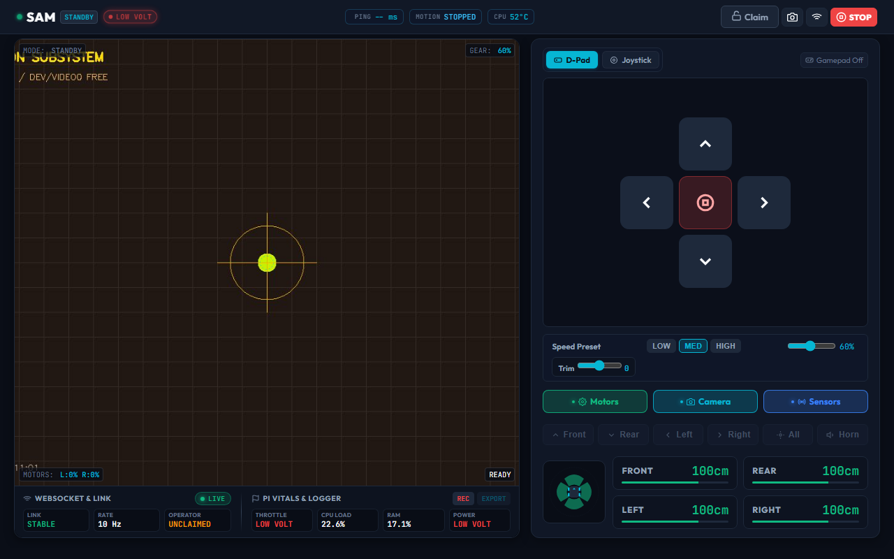

# SAM Rover — End-User Product Guide & Quick-Start Manual

**Welcome to your SAM Rover!**  
This guide will walk you through unboxing, powering on, connecting to Wi-Fi for the first time, and driving your rover from your phone, tablet, or laptop — no programming or technical setup required.

---

## 1. What's in the Box

Before getting started, make sure your package contains the following items:

* **1x SAM Smart Mobile Rover** (fully assembled with HD camera, drive wheels, and front lights)
* **1x 12V Rechargeable Lithium-Ion Battery Pack**
* **1x Smart Battery Wall Charger**
* **1x Quick-Start Card** with your default access information

---

## 2. Getting to Know Your Rover

Take a moment to familiarize yourself with the parts of your rover:

```
                          [ HD Front Camera ]
                                   |
                                   v
             [ Front Left LED ] ======= [ Front Right LED ]
                    |                          |
                    v                          v
             +------------------------------------+
             |                                    |
[Left Wheel] |             ROVER BODY             | [Right Wheel]
             |                                    |
             |  [ Switch 1: Brain ]               |
             |  [ Switch 2: Motors & Lights ]     |
             |                                    |
             |         [ 12V Battery Bay ]        |
             +------------------------------------+
                                   |
                                   v
                         [ Rear Balance Caster ]
```

* **HD Camera**: Streams real-time video directly to your screen with ultra-low latency.
* **Front & Side LEDs**: Bright headlights and turn indicators for driving in low light.
* **Ultrasonic Eyes (Front & Sides)**: Smart distance sensors that automatically stop the rover before it hits an obstacle.
* **Switch 1 (Computer / Brain)**: Powers the onboard computer, Wi-Fi, and camera.
* **Switch 2 (Drive / Motors & Lights)**: Powers the motor drive wheels, headlights, and horn.
* **12V Battery Port**: Where your rechargeable battery plugs in securely.

---

## 3. First-Time Power On & Setup

Your rover is powered by a high-capacity 12V Lithium-Ion battery with dual safety power switches. Follow these 3 simple steps to power it on:

```
[ Step 1: Connect Battery ]  -->  [ Step 2: Turn ON Switch 1 ]  -->  [ Step 3: Turn ON Switch 2 ]
  Plug 12V power jack               Computer starts (~25 sec)          Motors & lights ready!
```

### Step 1: Connect the Battery
1. Place the rover on a flat, clear surface (such as a floor or table).
2. Insert the charged **12V battery pack** into the rover's battery bay.
3. Plug the battery power connector firmly into the rover's power socket.

### Step 2: Turn ON Switch 1 (Rover Computer)
1. Flip **Switch 1** to the **ON** position.
2. A red light inside the rover will illuminate.
3. Wait about **25 to 30 seconds** for the rover's computer to boot up.
4. When ready, the rover will automatically broadcast its own private Wi-Fi network!

### Step 3: Turn ON Switch 2 (Motors & Lights)
1. Flip **Switch 2** to the **ON** position.
2. The motor system and lights are now powered and ready to drive.

> **Tip:** Always turn **Switch 1** on first, and turn **Switch 2** off before storing your rover to conserve battery!

---

## 4. Connecting to Your Rover's Wi-Fi

On first boot, your rover creates its own personal Wi-Fi network so you can connect directly without needing an internet router.

```
+-------------------------------------------------------------------------+
| FIRST-TIME WI-FI CONNECTION                                             |
|                                                                         |
| 1. Open Wi-Fi on Phone/Laptop ---> Select "SAM_ROVER_WIFI"              |
| 2. Enter Password: "raspberry"                                          |
| 3. Open Web Browser           ---> Go to: http://sam.local (or :8000)        |
+-------------------------------------------------------------------------+
```

### Step 1: Connect to the Rover's Wi-Fi
1. On your smartphone, iPad, tablet, or laptop, open your **Wi-Fi Settings**.
2. Look for the network named:
   ```
   SAM_ROVER_WIFI
   ```
3. Tap it and enter the default password:
   ```
   raspberry
   ```
4. Wait 3–5 seconds until your device displays the Wi-Fi connected checkmark. *(If your phone says "Internet not available", tap **Keep Wi-Fi Connection** — this is normal because the rover is communicating directly with your device).*

---

### Step 2: Open the Control Dashboard
1. Open any web browser (Safari, Chrome, Firefox, or Edge).
2. Type the following address into the URL bar and press enter:
   ```
   http://sam.local:8000
   ```
   *(If `sam.local` doesn't load on your device, type: `http://10.42.0.1:8000`)*
3. The **SAM Rover Live Dashboard** will immediately open on your screen showing your live HD camera feed!

---

## 5. Connecting Rover to Your Home or School Wi-Fi (Optional)

Once connected, you can easily link your rover to your home, office, or classroom Wi-Fi so that you don't have to switch Wi-Fi networks every time you want to drive!

```
[ Top Toolbar ]  -->  [ Tap Wi-Fi Icon ]  -->  [ Select Your Wi-Fi & Enter Password ]  -->  [ Connected! ]
```

1. In the top navigation toolbar of the rover screen, tap the **Wi-Fi Icon** button (next to the camera snapshot icon).
2. The **Wi-Fi & Network Manager** window will open.
3. Tap **`Scan Networks`** to see all nearby Wi-Fi routers.
4. Select your home or school network from the list.
5. Type your Wi-Fi password and tap **`Connect`**.
6. Within a few seconds, the rover will connect to your router and display its new network address.
7. Now, any phone or laptop on your home Wi-Fi can open the rover by typing `http://sam.local:8000`!

---

## 6. How to Drive & Control Your Rover

The dashboard is designed to be intuitive, responsive, and fun. Here is how to take control:

```
+--------------------------------------------------------------------------------------+
| [o] LIVE | RTT: 11ms | MODE: DRIVER | [ Claim / Release ] | [Camera] | [WiFi] | [ STOP ] |
+------------------------------------------------------+-------------------------------+
| LIVE CAMERA FEED                                     | CONTROLS DECK                 |
|                                                      |                               |
|                     +                                |        [ FORWARD ]            |
|                                                      |  [ LEFT ] [ STOP ] [ RIGHT ]  |
|                                                      |        [ REVERSE ]            |
|                                                      |                               |
| [MOTORS: L:0% R:0%]                     [HUD: READY] | [ Joystick Tab ] [ D-Pad Tab] |
+------------------------------------------------------+-------------------------------+
| SPEED GEARS:  [ LOW (30%) ]   [ MED (60%) ]   [ HIGH (90%) ]                          |
| LIGHTS:       [ FRONT ] [ REAR ] [ LEFT ] [ RIGHT ] [ ALL ON ]                       |
| AUDIO:        [ HORN BEEP ]                     CONTROLLER:   [ Touch / Keys Ready ]  |
+--------------------------------------------------------------------------------------+
```

### Step 1: Claim Control Authority
To prevent two people from driving at the same time:
* When you open the page, tap the amber **`Claim`** button in the top bar.
* The badge turns bright green and says **`DRIVER (YOU)`**.
* You now have complete driving control!

---

### Step 2: Choose Your Favorite Control Method

You can drive using any of these 3 methods:

#### Method A: On-Screen Touch D-Pad (Phones & Tablets)
* Tap the big directional buttons on your screen:
  * **Up Arrow**: Drive Forward
  * **Down Arrow**: Drive Backward
  * **Left Arrow**: Spin Left
  * **Right Arrow**: Spin Right
  * **Center Button**: Stop

#### Method B: Touch Virtual Joystick (Thumb Control)
* Tap the **`Joystick`** tab above the controls.
* Touch and drag the glowing cyan joystick knob with your thumb.
* Push forward to accelerate, pull back to reverse, and steer left/right smoothly with proportional turning.
* Release your thumb to stop instantly!

#### Method C: Keyboard (Laptops & Desktops)
* **`W`** or **`Up Arrow`**: Forward
* **`S`** or **`Down Arrow`**: Reverse
* **`A`** or **`Left Arrow`**: Spin Left
* **`D`** or **`Right Arrow`**: Spin Right
* **`Spacebar`**: Instant Emergency Brake
* **`H`**: Beep the Horn
* **`L`**: Toggle Headlights On/Off

---

### Step 3: Speed Gears (Choose Your Pace)

Tap any of the speed preset buttons to match where you are driving:

| Gear | Speed | Best For |
| :--- | :--- | :--- |
| **`25%` (Crawl)** | Super Slow & Gentle | Driving through tight doorways, indoor precision, cautious parking. |
| **`50%` (Normal)** | Balanced Cruiser | Ideal default for living rooms, classrooms, and smooth floors. |
| **`75%` (Fast)** | Speedy Patrol | Hallways, driveways, and open spaces. |
| **`100%` (Turbo)** | Full 60 RPM Speed | Maximum hill climbing power, thick carpet, outdoor pavement. |

---

### Step 4: Lights & Horn

* **Headlights & Tail-lights**: Tap **`Front`**, **`Rear`**, **`Left`**, **`Right`**, or **`All`** to light up the path ahead.
* **Audio Horn**: Tap and hold the **`Horn`** button to sound the buzzer chirp — great for warning pets or people in the hallway!

<p align="center">
  
  <br>
  <em>Figure: Live camera view, directional LED controls, horn button, and real-time obstacle sensors on the SAM Dashboard.</em>
</p>

---

## 7. Built-in Smart Safety Features

Your SAM Rover is equipped with smart safety systems designed to protect the vehicle and your surroundings:

1. **Smart Automatic Obstacle Braking**:
   * If the rover detects a wall, table leg, or person in front closer than **35 cm**, it will automatically slow down.
   * If you get closer than **15 cm**, it will **automatically stop forward motion** to prevent a crash, while still allowing you to steer or reverse safely away!
2. **Connection Loss Safety (Watchdog)**:
   * If your phone battery dies, Wi-Fi drops, or you close the browser tab, the rover will **automatically stop moving within 1.5 seconds**. It will never run away out of control.
3. **Emergency Stop (STOP Button)**:
   * The bright red **`STOP`** button is always visible in the top-right corner. Tapping it halts all motors immediately.
4. **Auto-Release Handover**:
   * If you stop driving for 3 minutes, the rover automatically releases control so a friend or classmate can take a turn.

---

## 8. Battery Charging & Daily Care

To keep your rover performing at its best, follow these battery care tips:

```
[ Battery Jack ] ---> [ Plug Into Included Wall Charger ] ---> [ Red = Charging | Green = Ready! ]
```

* **When to Recharge**: When the motors sound slightly weaker or the top dashboard bar shows a `LOW VOLT` badge, it is time to recharge.
* **Charging Time**: Disconnect the battery from the rover and plug it into the wall charger. The charger LED shines **Red** while charging and turns **Green** when full (typically 2 to 3 hours).
* **Storage**: When you are finished driving for the day, turn **Switch 2** OFF, turn **Switch 1** OFF, and unplug the battery connector. Store the rover in a dry, cool location.
* **Cleaning**: Wipe the wheels and camera lens with a clean microfiber cloth. Remove any carpet fibers or dust that collect around the wheel axles.

---

## 9. Quick Troubleshooting Guide

| What you see | Why it happens | Easy Fix |
| :--- | :--- | :--- |
| **Cannot find `SAM_ROVER_WIFI` in Wi-Fi list** | Rover is still booting up or battery is disconnected. | Check that the 12V battery is plugged in and **Switch 1** is turned ON. Wait a full 30 seconds for the Wi-Fi to appear. |
| **Page says "Cannot open website" or times out** | Device is not connected to the rover's Wi-Fi. | Open your phone's Wi-Fi settings. Confirm you are connected to `SAM_ROVER_WIFI`. Then go to `http://sam.local:8000` (or `http://10.42.0.1:8000`). |
| **Camera shows video, but wheels don't turn when I press buttons** | 1. Control lease is not claimed.<br>2. Switch 2 is turned OFF. | 1. Tap the amber **`Claim`** button in the top bar so it turns green.<br>2. Check that **Switch 2** (Motors & Lights) is flipped **ON**. |
| **Rover moves very slowly or stops on carpet** | Speed gear is set to 25% or battery is getting low. | Tap the **`50%`** or **`100%`** speed button. If still sluggish, plug the battery in to recharge. |
| **"Observer Mode" message appears on screen** | Another device is currently controlling the rover. | Have the other person tap **`Release`**, or tap **`Take Control`** to switch the driver to your device. |
| **Rover drives slightly crooked when going straight** | Normal friction differences between the left and right motor. | Slide the **Steering Trim** slider slightly left or right on the dashboard until it drives straight. |
| **Front lights or horn don't work** | Rover is in Standby mode. | Tap **`Claim`** to claim driver authority. The lights and horn will now toggle on demand. |

---

## 10. Summary Quick Reference Card

Keep this summary handy for quick driving sessions:

```
1. Turn ON Switch 1 (Brain) & Switch 2 (Drive)
2. Connect phone/laptop Wi-Fi to: SAM_ROVER_WIFI (Password: raspberry)
3. Open browser and visit: http://sam.local:8000  (or 10.42.0.1:8000)
4. Tap the amber "Claim" button -> Start driving!
```

**Enjoy exploring with your SAM Rover!**
